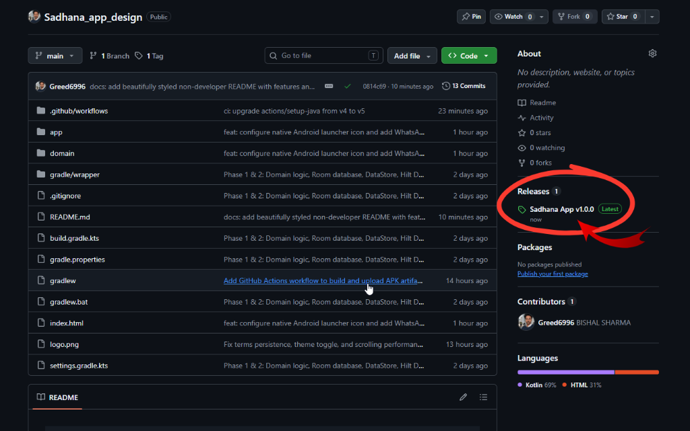
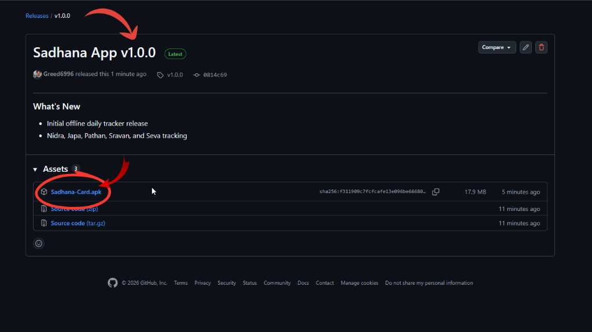

<div align="center">

```
╔══════════════════════════════════════════════════════════════════════════════╗
║                                                                              ║
║                           🪷  S A D H A N A   C A R D                         ║
║                                                                              ║
║           Daily Devotional Journal & Spiritual Habit Tracker                 ║
║                                                                              ║
╚══════════════════════════════════════════════════════════════════════════════╝
```

[](https://github.com/Greed6996/Sadhana_app)
[](https://github.com/Greed6996/Sadhana_app)
[](https://github.com/Greed6996/Sadhana_app)
[](https://github.com/Greed6996/Sadhana_app)

<br />

<p align="center">
  <a href="https://github.com/Greed6996/Sadhana_app/releases">
    
  </a>
  <a href="https://github.com/Greed6996/Sadhana_app/releases/latest">
    
  </a>
</p>

> 📲 **Mobile Users:** Can't see the "Releases" tab on your phone? Tap **[📥 Download Sadhana-Card.apk Directly](https://github.com/Greed6996/Sadhana_app/releases)** to get the latest app installer with one tap!

*A calm, modern, and disciplined digital companion designed to replace traditional paper cards with effortless daily devotional logging.*

---

</div>

## 📖 What is Sadhana Card?

In devotional life (*Bhakti Yoga*), steady daily practice (**Sadhana**) is the foundation of inner peace, clarity, and spiritual progress. 

For decades, practitioners have manually maintained physical paper cards — checking boxes each evening for wake-up time, chanting rounds, book reading, and service. While the tradition is timeless, paper cards easily get lost, crumpled, or forgotten.

**Sadhana Card** brings this sacred habit into the modern era:
* **No more lost papers:** Keep your weekly and monthly devotional journey cleanly organized on your phone.
* **Instant automatic scoring:** The app calculates your daily scores (out of 20 points) and weekly aggregates (out of 140 points) automatically.
* **100% peaceful & distraction-free:** No pop-up advertisements, no social media feeds, and no account creation required.

---

## 🎯 Who is this App For?

* **Devotees & Practitioners (Sadhakas):** Build consistent morning habits, finish chanting earlier in the day, and dive deeper into scriptural study.
* **Mentors, Guides & Counselors:** Easily review weekly sadhana records through clean, pre-formatted WhatsApp reports.
* **Spiritual Seekers:** Anyone looking to cultivate mindful daily routines — early rising during *Brahma Muhurta*, focused meditation, reading, and selfless service.

---

## 🪷 The 5 Daily Practices You Track

Every day is scored up to **20 points**, following the standard devotional scoring rubric:

| Practice | What You Record | Why It Matters |
| :--- | :--- | :--- |
| 🌅 **Early Rising (Wake-Up)** | Exact time you wake up | Rising during *Brahma Muhurta* (before 4:00 AM) brings peaceful, sattvic energy for prayer and japa. |
| 🛏️ **Rest & Sleep (Nidra)** | Bedtime & afternoon rest | Healthy sleep discipline ensures physical vitality and alertness for morning devotion. |
| 📿 **Mantra Meditation (Japa)** | Rounds chanted by deadline | Track completion of the Hare Krishna Maha-Mantra before morning programs and midday. |
| 📖 **Scriptural Study (Pathan)** | Minutes spent reading | Immersing the mind in sacred wisdom (Bhagavad-gita, Srimad-Bhagavatam, and Srila Prabhupada's books). |
| 🎧 **Hearing & Service (Sravan & Seva)** | Minutes spent listening & serving | Attentive hearing of kirtan and lectures, combined with active practical service for the community. |

---

## 🌟 Key Highlights & Features

### 📅 Daily & Weekly Matrix View
- **Daily Journal:** Tap through simple score buttons and time pickers in seconds at the end of each day.
- **7-Day Matrix:** Review your entire week at a glance with color-coded score indicators (0 to 5 points per category).

### 💬 Easy WhatsApp Sharing & Feedback
- **Share to Counselor:** Generate a beautifully structured weekly report with one tap and share it directly to your mentor or counselor on WhatsApp.
- **Feedback & Feature Requests:** Have an idea or found a problem? Connect with the developer directly on WhatsApp right from the Weekly screen.

### 🔒 100% Private & Offline-First
- Your devotional records are personal and sacred.
- **Zero data leaves your phone:** Everything is saved locally on your device.
- Works completely without an active internet connection.

---

## 📱 How to Download & Install (For Non-Developers)

Installing the app onto your Android phone takes less than a minute. Follow these simple steps:

### 🔹 Step 1: Tap the Download Link (or Open "Releases")
- **On Mobile Phones:** Simply tap the **[📲 Download Sadhana-Card.apk](https://github.com/Greed6996/Sadhana_app/releases/latest/download/Sadhana-Card.apk)** button at the top of this page to download immediately!
- **On Desktop Computers:** On the right-hand sidebar of this repository page, locate the **Releases** section (or click **[Latest Release](https://github.com/Greed6996/Sadhana_app/releases/latest)**):

<p align="center">
  
</p>

---

### 🔹 Step 2: Check the Version & Download `Sadhana-Card.apk`
On the release page, verify the version details, scroll down to the **Assets** list, and tap on **`Sadhana-Card.apk`** to download it directly to your phone:

<p align="center">
  
</p>

---

### 🔹 Step 3: Install & Open on Your Phone
1. Open your phone's **Downloads** folder (or tap the completed download notification) and select **`Sadhana-Card.apk`**.
2. If Android displays *"For your security, your phone is not allowed to install unknown apps from this source"*, tap **Settings** and toggle on **Allow from this source**.
3. Tap **Install**, then launch **Sadhana Card** from your home screen or app drawer to begin your daily devotional journal!

---

## 🌿 Devotional Inspiration

<div align="center">

> *“yukta-āhāra-vihārasya yukta-ceṣṭasya karmasu*  
> *yukta-svapnāvabodhasya yogo bhavati duḥkha-hā”*  
>  
> **“He who is regulated in his habits of eating, sleeping, recreation and work can mitigate all material pains by practicing the yoga system.”**  
> — *Bhagavad-gītā 6.17*

<br />

**Dedicated to sincere practice, steady discipline, and devotional progress.**

</div>
